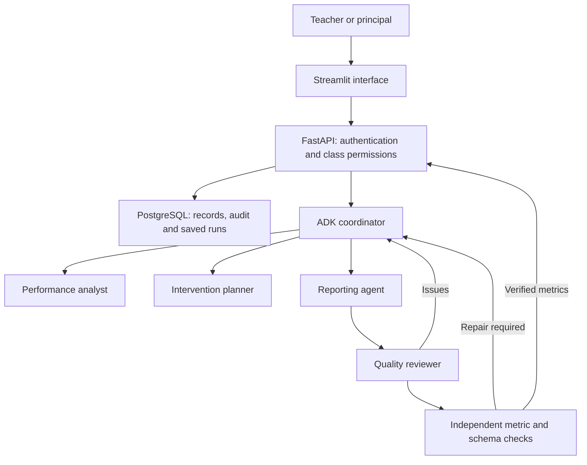

# Architecture and delivery status

The Performance Administrator is the first employee in scope. It supports teachers and principals with assessment administration, attendance evidence, learner support and verified reporting.

The coordinator uses ADK AgentTool delegation. Agents choose relevant specialist calls from the goal. Every agent receives the same serialised, permission-checked evidence snapshot directly in a callable instruction. This avoids a separate evidence-lookup model round trip and prevents JSON braces from being interpreted as session-state placeholders. Agents cannot select arbitrary classes or modify official marks. The host requires reporting and reviewer delegation and independently validates the final structured metrics. There are at most two repairs after the initial answer and a wall-clock timeout. A model-request budget applies across the whole report, including repairs. No fake agent output substitutes for a missing key or provider failure.

Coordinator and specialist requests share one per-model pacing gate in the API process, with an initial 60-second cooldown. SDK automatic retries are disabled, and all actual model requests are recorded by a before-model callback. This is a single-process gate, not a distributed or project-wide quota ledger. External requests, daily allowance and multiple replicas require additional coordination before production rollout.

`verified_metrics` means the structured numerical fields match source evidence and the delegation gate passed. It is not certification of every narrative claim, a guarantee of educational accuracy, or proof of improved outcomes. Staff remain accountable for consequential academic decisions. Raw model thoughts are excluded from the saved trace. Tool names, agent authors, review issues and results remain visible.

Records and completed run summaries persist in SQL. The ADK conversational session is currently in memory for the duration of one job, so in-flight AI work cannot resume after process failure. A durable background worker and persisted ADK sessions are the next workflow milestone.

## Implemented foundation

- Password hashing, expiring hashed session tokens, logout and school/class access checks.
- Principal onboarding of staff, classes and learner rosters.
- Atomic marks/attendance imports with duplicate and range checks.
- Aggregate/topic/learner evidence with explicit missing-mark coverage.
- Audited mark corrections, intervention assignment and follow-up.
- Live ADK report delegation with bounded numerical repair and saved run results.
- Streamlit UI, Codespaces configuration, Docker packaging, tests and source documentation.

## Next deliveries for the full project

1. Versioned database migrations, staff account recovery/rotation, and administration audit coverage.
2. Assessment schedules, formal weights, grade/subject rules and curriculum evidence.
3. Digital-script rubric assessment and teacher moderation. Handwriting OCR follows extraction validation.
4. Teaching continuity agent backed by approved lesson resources and reviewed cover packs.
5. Durable jobs, scheduled reports, notification outbox, safe retries and delivery tracking.
6. Authenticated hosted deployment with durable SQL/object storage, backup/restore, retention, load tests and school pilot validation.

This is an incremental implementation of a real system. It is not a claim that the entire employee is complete, production-hardened, deployed or validated with a school. No predictive failure probabilities or measured time savings are claimed.

## Data definitions

The descriptive mean uses total earned / total possible across marked assessment-topic records. It does not implement official promotion or term weighting. Expected coverage is the class roster multiplied by the distinct assessment-topic pairs already represented in the database. An entirely absent assessment cannot be detected until an assessment calendar exists. Attendance counts describe supplied records only, not a full school-calendar attendance rate.

Initial users have principal or teacher roles and one school identifier. Class access currently follows teacher assignment at class/subject level. Multi-school deployments require formal school lifecycle management and verified tenancy tests before rollout.

## References

- https://adk.dev/graphs/
- https://adk.dev/runtime/event-loop/
- https://containers.dev/guide/dockerfile
- https://docs.github.com/en/codespaces
