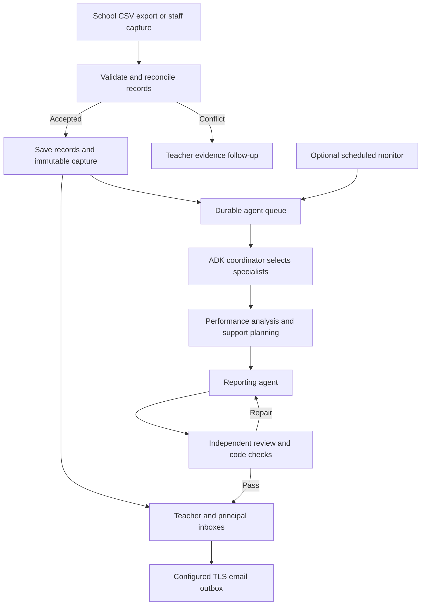

# Agentic architecture and delivery status

The goal is an autonomous Digital Performance Administrator Employee. Every accepted capture evaluates authorised school records, identifies evidence gaps, creates teacher follow-ups, delivers data reports and queues goal-driven agent investigations automatically. Scheduled monitoring is an additional principal-controlled policy.

## Control and data flow

The ADK coordinator generates a typed plan from the goal and snapshot. Its decisions control whether the performance analyst and intervention planner run. The reporting agent and independent reviewer are mandatory. Specialist outputs and prior review feedback are passed explicitly to later agents. Host code executes the selected stages and constrains the available actions.

This preserves goal interpretation, selective delegation, evidence-based reasoning, evaluation and feedback. It is a bounded autonomous workflow, not a claim that the full school employee is complete. The observer and action permissions are code-enforced; an LLM does not decide its own database access.

## Durable execution

`AgentRun` preserves report history. New additive tables store jobs, immutable source snapshots, typed stage checkpoints, dispatched-attempt counts, leases, monitoring policies, follow-ups, worker heartbeat and daily automatic-initiation budgets.

The API queues work and returns 202 without waiting for the model. A separate worker claims one stage with an atomic compare-and-set lease. Checkpoint writes require the matching unexpired lease. Cancellation clears the lease; stale workers cannot publish over a newer owner. A unique nullable active-class slot prevents simultaneous active reports for a class.

Completed stages survive process restarts. Provider errors affect the unfinished stage. Bounded transient retries are delayed in the database; quota/authentication failures pause. An explicitly configured backup can handle a failed stage. Manual resume preserves successful predecessors and the total request-attempt budget. Current-state investigations recheck source freshness before publication. Capture reports explicitly retain their own immutable historical snapshots.

This is application-level checkpointing around short ADK stage invocations. ADK conversational sessions are temporary inside one stage. ADK's native whole-invocation Resume feature is not enabled or required by this implementation. Inference is at least once across an abrupt crash; no exactly-once provider billing guarantee is made.

Default full-path cost is five successful stage dispatches, with additional attempts for provider failures and repairs. The shared budget defaults to ten dispatched attempts across the entire report, including manual resumes. At most two report/review repair cycles are allowed. Each stage permits one model inference and has its own deadline.

## Autonomous monitoring and action

Policies are principal-controlled and off by default. Enabled policies run on an interval and can wake after authorised record changes. They produce follow-ups for missing captured marks, source-defined learner support flags, supplied absence records and overdue recorded interventions. Follow-ups are assigned to the current teacher, close when the recorded issue disappears, and become visible as escalated to the principal when overdue. Staff resolutions require recorded evidence.

Optional AI investigations start when the evidence hash changes and the per-class and installation-wide daily caps permit. The installation budget is reserved atomically in SQL. These are initiation caps per UTC day, not provider usage ledgers. Cancelled or failed automatic work conservatively consumes its initiation slot. Disabling automatic AI prevents queued monitor jobs from dispatching new requests.

Follow-up assignment and escalation occur inside this application. Reports are routed automatically to staff inboxes and, when configured, the durable TLS SMTP outbox. Follow-up escalation is in-app; SMS is not implemented. The worker must remain running; restarting a Codespace does not create an always-on hosted employee.

## Providers and review

ADK stages use Gemini directly or Groq through the pinned LiteLLM connector. No key is stored in job state. Fallback is explicit, provider errors use credential-safe metadata, and raw model thought parts are excluded. A compact snapshot discloses omitted individual/topic/intervention details while retaining full-class aggregate metrics.

Each worker has a per-model request gate; Gemini starts with a 60-second cooldown. SDK automatic retries are disabled. This does not coordinate external applications, provider daily/token quotas or multiple worker replicas. Distributed provider rate limiting is required before scaling workers.

The reporting agent's structured metrics and the independent reviewer's checked metrics must match the immutable source. Approval with unresolved issues is blocked. `verified_metrics` means these checks passed; it does not certify every narrative claim, official academic decisions or educational effectiveness. Intermediate model outputs remain labelled drafts. Marks can change through authenticated staff correction or a configured, scoped source with audited correction authority. Official term/promotion rules are not implemented.

A deterministic statistical report is available without AI and is explicitly labelled as having no AI interpretation.

## Remaining full-employee work

- Curriculum/assessment calendars, official weighting and grade/subject rules.
- Script extraction, rubric-based assessment and teacher moderation.
- Teaching-continuity planning from approved resources and reviewed cover materials.
- Additional communication channels, live mail-service validation and delivery operations.
- Staff account recovery, fuller administration audits and formal versioned migrations.
- Distributed rate/usage controls, backup/restore, hosting, retention, load tests and school pilot evaluation.

SQL `create_all` adds the new tables without altering old tables or recreating accounts. Formal production migration/version management remains necessary.

The current descriptive mean is earned / possible across marked topic records, not an official term/promotion mark. Expected coverage is roster size times assessment-topic pairs already represented in the database. Entirely absent assessments need the future assessment calendar. Attendance summaries cover supplied records, not the complete school calendar.

Sources:
- https://adk.dev/agents/models/litellm/
- https://adk.dev/runtime/resume/
- https://console.groq.com/docs/models
- https://docs.github.com/en/codespaces

## Capture-driven operation (v0.3)

Accepted record changes transactionally save an immutable CaptureEvent and a data evaluation delivered to role-derived staff inboxes. The background control loop scans CSV sources, processes idempotent batches, queues the captured ADK evaluation and dispatches the TLS SMTP outbox independently of slow model stages. The evaluation loop plans specialist work, validates approved actions and source metrics, repairs bad stages and delivers reviewed results. Each capture retains its own snapshot. Source conflicts become teacher exceptions; the system does not fabricate missing marks. See [complete automatic workflow](automatic-capture.md) for implemented capabilities and limits.
